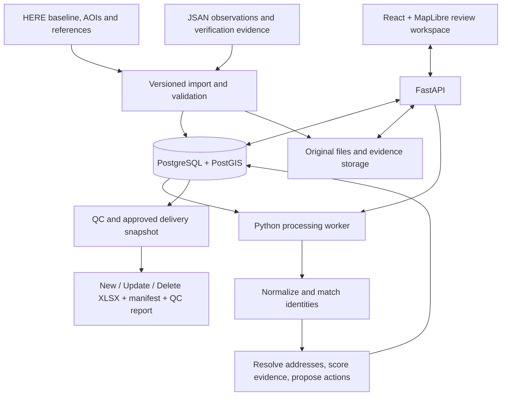

# JSAN SEA Places POC: architecture and work process

Prepared 26 October 2026 from the supplied POC Material folder and current repository. This is a proposed implementation plan, not a claim that the POC processing is implemented. PDF text and spreadsheet structures were inspected; embedded PDF diagrams were not visually reviewed.

## Objective and scope

Demonstrate JSAN's ability to improve HERE Places coverage and quality in three assigned AOIs by comparing independently verified supplier observations with the HERE baseline, producing traceable New, Update and Delete deliveries, and meeting the supplier delivery guide's quality controls.

The map is the analyst workspace. The deliverable is a reconciled, evidence-backed data package. Point Address product creation and street-network naming are separate tracks; structured POI addresses remain in scope.

| AOI | Baseline CSV records | Unique place IDs within file |
| --- | ---: | ---: |
| Divisoria, Philippines | 3,636 | 3,636 |
| Kampung Bali, Indonesia | 6,174 | 6,174 |
| Thanon Phaya Thai, Thailand | 8,351 | 8,351 |
| Total | 18,161 | |

Counts were parsed from CSV contents. The Indonesia and Thailand filenames understate their contents by one record each. Cross-file ID uniqueness and geometric containment still require import validation.

Inputs inspected: four PDF guides/frameworks, three XLSX action templates, category/chain/profanity metadata, a parent-child example, three AOI GeoJSON files with QGIS metadata, and three baseline CSVs. Spreadsheet dimensions include formatting and do not represent populated POI counts. The action templates have headers but no populated data rows encountered during inspection.

## Current application and proposed architecture

The repository provides React/MapLibre viewing, browser-side file imports, FastAPI health endpoints, and a PostgreSQL/Alembic scaffold. It has no implemented POI persistence models, reconciliation engine, evidence workflow, or controlled XLSX delivery pipeline.

Keep one modular application and one worker initially. Store import/reconciliation/export jobs durably with status, retry count, input version and error report. Use a worker process for batch work rather than tying it to HTTP request lifetime. A separate queue service can be introduced if concurrency warrants it.

Use PostGIS for AOI containment, spatial candidate lookup and measured distances. `ST_DWithin` on geography supports metre-based thresholds; `ST_Covers` can include boundary points, subject to agreement on AOI edge policy. Store display and routing points separately.

Store original files and permitted evidence attachments in persistent object storage; retain hashes, timestamps and source references in the database. Restrict analyst/reviewer/export permissions and log changes. Avoid overwriting baseline data.

Core entities:

- `projects`, `aois`, `import_batches`, `source_files`: scope and reproducible input versions.
- `baseline_pois`, `supplier_observations`: immutable baseline and independently supplied observations, retaining raw attributes.
- `categories`, `chains`, `profanity_rules`, `poi_relationships`: controlled reference versions and parent/child links.
- `match_candidates`, `attribute_changes`, `address_resolutions`: candidate signals, before/after values and rule results.
- `evidence_items`, `evidence_assessments`: type, observation date, retrieval date, outlet identity, provenance, independence and rubric score.
- `decision_runs`, `reviews`, `audit_events`: proposed/approved action, rule version, reasoning, actor and history.
- `qc_issues`, `jobs`, `delivery_snapshots`, `delivery_files`: execution state and reproducible exports.

Internal states must include UNCHANGED, PENDING_VALIDATION and REJECTED alongside proposed NEW/UPDATE/DELETE. Only approved changes enter action files. A missing supplier match is not itself an action.

## Step-by-step implementation and operating process

1. **Freeze the initial specification.** Register the exact template and reference versions. Create a clarification log for conflicting draft rules. Obtain the missing field dictionary, POC introduction, special-location guidance and agreed manifest/checklist. Record which rules are provisional.
2. **Build persistent ingestion.** Import all three AOIs and baseline extracts. Preserve IDs as strings, raw records, file hashes and import lineage. Validate encoding, coordinates, uniqueness, country and AOI membership. Quarantine invalid rows; reconcile accepted/rejected totals against source counts. Reloading a batch must not duplicate records.
3. **Load references.** Import full HERE category codes from the supplied mapping sheets, chains and profanity rules. The Category sheet's `Last-4` column contains `#REF!` values, so do not use it as the authoritative category ID. Respect the profanity table's whole-name flag and country/language restrictions. Validate parent references and prevent relationship cycles.
4. **Acquire supplier observations and evidence.** Bring in JSAN's licensed source dataset, field surveys, official-source checks and available imagery/POS evidence. Capture collection and verification dates, source rights, outlet-level identity and evidence provenance. Missing evidence becomes a work queue. Baseline data alone cannot establish uplift or closure.
5. **Normalize without losing source values.** Separate local name, transliteration, phone, domain, category, structured address, display point and routing point. Apply market-specific normalization; preserve Thai and other local scripts. Keep chain membership distinct from the physical parent complex.
6. **Generate and review matches.** Search distance bands of 0–50 m, over 50–250 m, over 250–1,000 m, followed by identity-led relocation investigation outside the radius. Use name, category, phone, address/unit and domain signals together. The deletion framework specifies normalized name similarity >=0.85 plus at least one phone/address/domain signal for identity confirmation, with branch-level safeguards for chains. These are candidate rules requiring pilot validation, not guaranteed universal matching accuracy.
7. **Resolve addresses and relationships.** Maintain primary road-level and local unit-level address slots. Preserve both when valid. Store rule IDs and evidence. Automating road-class and complex-containment rules needs HERE road geometry/functional classes and complex polygons, which are not in this folder. Route unsupported cases to review; do not fabricate roads or house numbers. Adapt Indonesia-specific naming rules before using them in Thailand or the Philippines.
8. **Assess evidence and propose actions.** Check action-specific evidence completeness before calculating confidence. Keep general record confidence separate from closure scoring. NEW requires at least two independent evidence types, including imagery or POS under the workbook; UPDATE evidence must support the changed fields. Apply spatial/identity checks before considering DELETE. Positive liveness conflicts block automated deletion and trigger review.
9. **Build the analyst workflow.** Add project/AOI selection, import status, baseline/candidate map layers, side-by-side record comparison, changed-field highlights, evidence panel, scores with explanations, reviewer decisions and field-verification tasks. Display current disposition and provenance for every POI. Link predecessor/successor records for supersession.
10. **Run a complete pilot.** Start with a small representative Kampung Bali batch because the detailed frameworks focus on Indonesia. Include unchanged POIs, new candidates, coordinate errors, chain branches, mall tenants, dual addresses, relocation, conflicting evidence and supported closures. Test through export before scaling to all AOIs. Keep a separately verified sample for evaluation; do not tune and evaluate exclusively on the same cases.
11. **Validate and approve.** Check required fields, IDs, categories, coordinates, address consistency, freshness, relationships, evidence, duplicate candidates and cross-file conflicts. No unresolved Blockers may pass the submission gate. Correct Major issues or disclose their impact and counts as the guide requires. Validate spatial decisions at distance boundaries and ensure reruns produce identical outcomes for unchanged inputs/rules.
12. **Export a frozen delivery.** Populate copies of the supplied XLSX templates using an explicit mapping for each action; their headers differ. Preserve controlled sheets, names and column order. Exclude template formatting-only rows from output counts. Preserve HERE place IDs for Update/Delete and stable supplier IDs for New. Reopen exports and verify content, IDs, counts, no external links, and template compatibility.
13. **Package and measure.** Produce the three action files, manifest, completed QC checklist, category mapping/unmapped values, limitations and requested supporting files. Snapshot approvals, rule/template versions and checksums. Submit through the agreed channel only when separately authorized; this plan does not send data.

## Decision rules and unresolved specification issues

The evidence workbook proposes weights: imagery 20%, POS 20%, official website 20%, official social 20%, competitor/third-party reference 15%, other images 5%. The formula is `10 * sum(weight * evidence_score)`. Store component scores and raw total so it remains explainable.

The separate deletion framework proposes closure tiers E1 override, E2=60, E3=35 and E4=10; weighted deletion requires >=70 and at least two independent tiers, with liveness blocking deletion. Rules D1–D7 prioritize retention, geometry correction and relocation before closure. Do not confuse the 1–10 confidence score with the closure score.

Items to resolve before automatic final decisions:

| Issue | Required clarification / interim implementation |
| --- | --- |
| Deletion framework says >=70 plus two tiers, but annotation says any two E2/E3/E4 | Keep draft rules versioned; use reviewer decisions for conflicting cases. |
| Workbook allows absence across evidence types; deletion spec requires positive closure evidence | Define precedence and approved evidence requirements. |
| Delivery guide includes duplicate/non-existent/invalid deletions; detailed deletion spec focuses on closure | Define separate approved reason codes and proof requirements. |
| Imagery recency differs: 3 months for full general score, 12 months for closure, 24 months for street ground truth | Model thresholds per purpose; confirm annotations rather than applying one global age limit. |
| Confidence formula can return zero, but scale says 1–10; rounded scores coexist with decimal bands | Agree zero handling, rounding and band boundaries; retain raw score. |
| Street resolution says terminate at first conclusive step, but examples preserve a losing candidate as a valid second address | Clarify dual-address handling before implementing early termination. |
| Address annotation suggests two corroborating sources in addition to weighted rules | Confirm source independence and precedence. |
| Controlled templates lack many internal audit fields | Keep audit data internally; agree any supporting-file mapping without adding controlled columns. |

## Acceptance and completion

Delivery guide targets: combined coverage 90%; extras/closed or no-longer-existing <=5%; name/category accuracy 95%; structured address accuracy 95%; display/routing point accuracy 95%; every record has a last verified date; on-time full-scope delivery. Obtain agreed denominators, sampling methods and spatial accuracy tolerances. Import completion and baseline reconciliation percentages are operational metrics, not evidence of ground-truth coverage.

The engineering POC is complete when an input batch can proceed through persistent import, evidence review, reproducible matching, approved decisions, QC and exact-template export. The data POC is complete only when actual supplier observations and independent verification support the full agreed AOI scope and delivery package.

## Sources

- Local `SEA_Places_POC_Supplier_Delivery_Guide_v1.2.pdf`, pp. 2–7: scope, classification, controls, packaging and targets.
- Local `POI_Delete_Decision_Framework_TechSpec_v1.0.pdf`, pp. 4–10: spatial bands, identity, closure evidence and D1–D7.
- Local `POI_Evidence_Weighting_Confidence_Scoring_Workbook_upd.pdf`, pp. 3–10: evidence weights, completeness and thresholds.
- Local `Street_Name_Resolution_Framework_TechSpec_v1.1(1)_upd.pdf`, pp. 4–11: dual addresses, resolution and audit fields.
- Supplied XLSX metadata/templates and parsed baseline CSV contents.
- [PostGIS ST_DWithin](https://postgis.net/docs/ST_DWithin.html), [PostGIS ST_Covers](https://postgis.net/docs/manual-3.7/en/ST_Covers.html).
- [FastAPI background-task guidance](https://fastapi.tiangolo.com/tutorial/background-tasks/): larger background work may warrant separate worker tooling.
